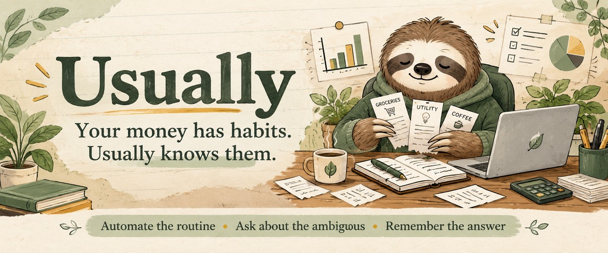
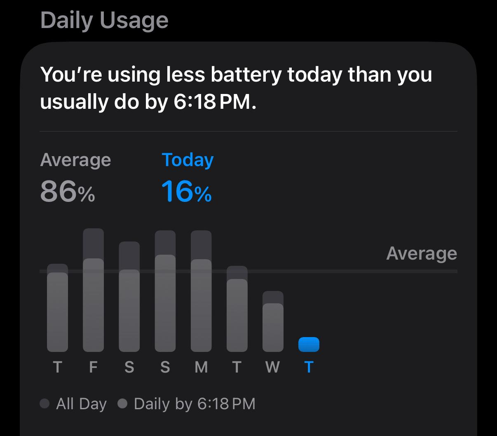
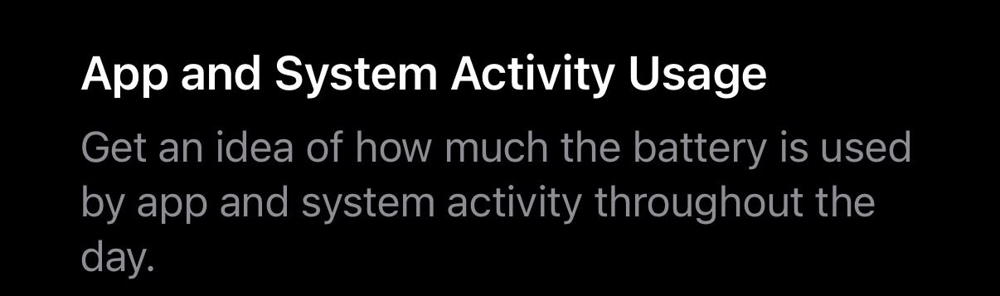
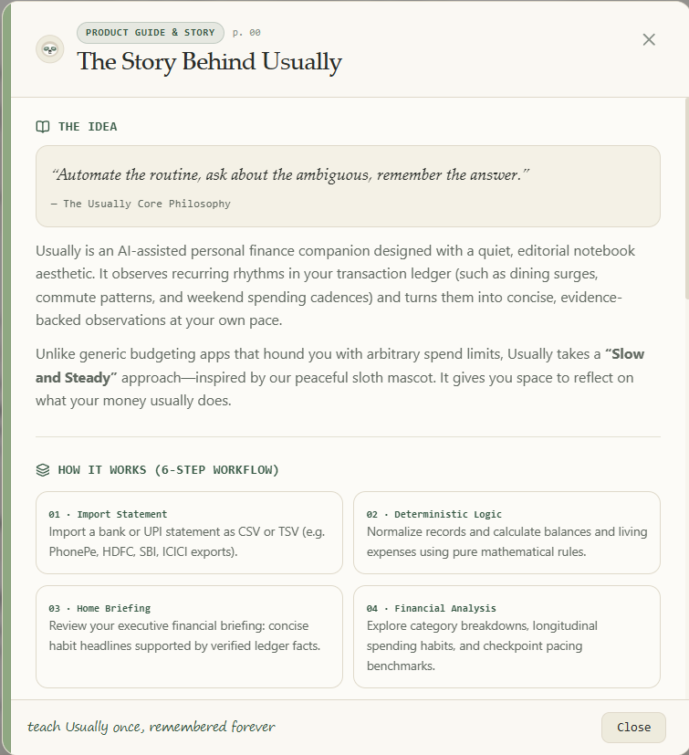
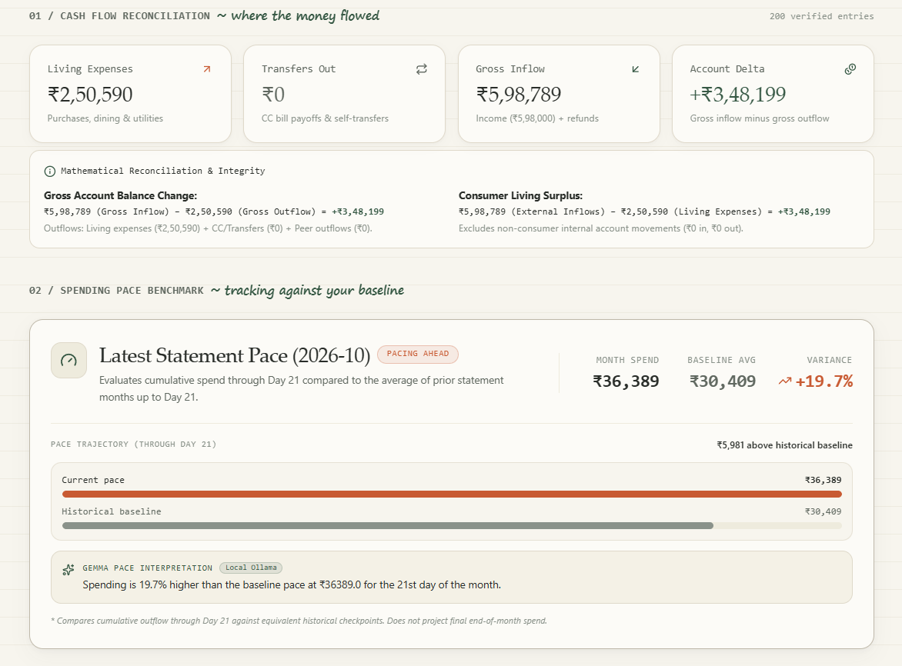
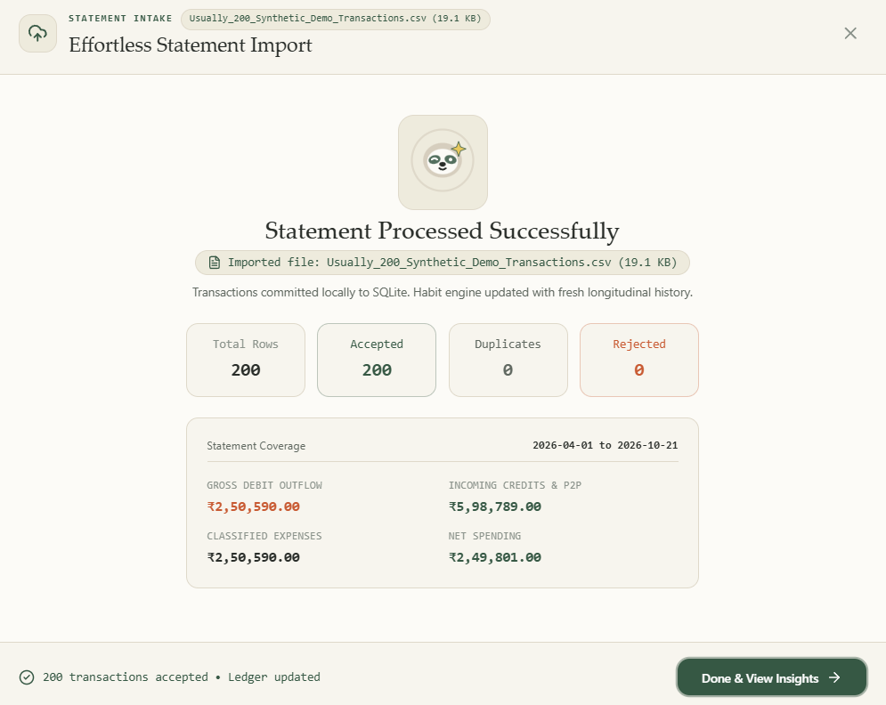
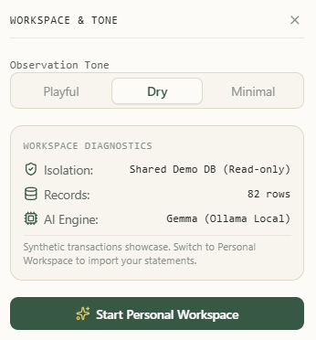
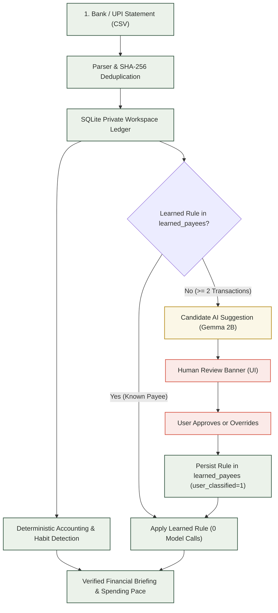

# Usually — Your Money Has Habits

> A quiet, local-first personal finance companion designed with a warm, editorial notebook aesthetic.
> Themed **“Slow and Steady”** with a peaceful sloth identity.

<p align="center">
  
</p>

[](https://opensource.org/licenses/MIT)
[](https://github.com/debashis-sharingan-21/usually)
[](https://github.com/debashis-sharingan-21/usually)
[](https://nextjs.org/)
[](https://fastapi.tiangolo.com/)
[](https://ollama.com/)

---

## Quick Links

- **Live Web Application:** [https://usually-tau.vercel.app/](https://usually-tau.vercel.app/)
- [Hacktoberfest Week 3 Submission Video](https://youtu.be/8uNvWrKJ2ts)
- [Website Walkthrough](https://youtu.be/1R1HhzmjI7o)
- **Live Cloud Backend:** [https://usually.onrender.com/](https://usually.onrender.com/) (Health: [/health](https://usually.onrender.com/health))
- **GitHub Repository:** [https://github.com/debashis-sharingan-21/usually](https://github.com/debashis-sharingan-21/usually)
- **Architecture Documentation:** [docs/architecture-audit.md](docs/architecture-audit.md)

---

## The Problem and the Solution

Understanding personal finances usually forces an unwelcome tradeoff:

1. **Tedious manual spreadsheets:** High maintenance friction, requiring manual categorization of cryptic bank descriptions and repetitive bookkeeping.
2. **Aggressive cloud aggregators:** Demand bank credentials, harvest sensitive transaction logs, and push guilt-inducing notifications.
3. **Overhyped AI financial bots:** Hallucinate arithmetic totals, invent psychological spending motives (*“retail therapy”*), and send financial data to third-party model APIs.

**Usually takes a different path:**
*“Automate the routine, ask about the ambiguous, remember the answer.”*

- **What Usually automates:** Pure deterministic math calculates income, living expenses, transfers, refunds, and spending-pace benchmarks. An algorithmic cadence detector identifies recurring rhythms (like dining cadences and weekend spending surges) backed strictly by verified transaction dates and counts.
- **Where it asks for human input:** When unfamiliar payees appear (>= 2 transactions), local Gemma 2B suggests candidate categories. You review, approve, or correct the suggestion once. Usually permanently remembers your classification in SQLite, applying it to all future imports with **zero repeat model calls**.

---

## The Inspiration: An iPhone Battery Insight

Usually began with a small interaction on my own iPhone: comparing today's battery usage with what is typical by the same time of day. That comparison inspired a similar question for personal finance: **what has my spending pace looked like so far, compared with my own history?**

These original iPhone screenshots are the inspiration, not part of the Usually interface. The battery figures shown belong to the phone screenshot and are not financial data.

<div align="center">
  
  
</div>

---

## Key Capabilities

- **Evidence-Backed Recurring Rhythms:** Statistical cadence detection identifies recurring spending patterns (e.g., *“You usually spend ₹450 on Swiggy on Wednesdays”*) supported by dates, transaction frequencies, and historical evidence.
- **Deterministic Financial Accounting:** Mathematical source of truth. Credit card repayments and self-transfers are segregated into transfer categories to prevent false consumption inflation. Non-negative balances and polarity equations remain inviolable.
- **Local Gemma 2B Merchant Assistance:** Open-weight Google Gemma 2B running on-device via Ollama evaluates raw, messy bank descriptors and proposes standard categories without sending financial data over the network.
- **Human-Confirmed Learning & Reuse:** AI suggestions are strictly candidate proposals (`Model estimate · Review required`). Once accepted or corrected by the user, the decision commits to `learned_payees` as an authoritative rule.
- **Inspectable Ledger & Statement Ingestion:** Resilient, filename-agnostic parser supporting standard CSV, TSV, and PhonePe exports with content-addressable SHA-256 deduplication, category filtering, search, and inline correction.

---

## Visual Experience & Views

### Application Previews

These screenshots show the Usually product story, financial analysis, statement import, and workspace controls. Import and analysis examples use synthetic demo data.

<div align="center">
  
  
</div>

<div align="center">
  
  
</div>

---

## How It Works

The workflow separates deterministic calculation, local AI assistance, and human decision boundaries:



### Key Design Choices

1. **Deterministic Accounting Barrier:** No large language model ever computes account balances, monthly totals, or transaction sums. Calculations live in pure Python (`backend/app/services/accounting.py`) and SQLite queries.
2. **Physical Workspace Isolation:** Personal data is segregated into individual SQLite databases (`workspaces/workspace_<user_id>.db`) operating in WAL mode. Guest sessions run in isolated sandboxes with one-click permanent deletion (`DELETE /api/auth/workspace`).
3. **Zero-Repeat Learning Loop:** Gemma assists only when unfamiliar merchants lack an established rule. Once confirmed, learned rules permanently bypass the model on subsequent imports.

---

## AI Behavior & Trust Boundaries

Usually strictly defines what AI is allowed to do and what it must never touch:

- **What Gemma 2B Does:** Suggests one of 12 canonical expense categories for raw, unfamiliar merchant strings (e.g., mapping `"SWIGGY54321 BANGALORE"` to `"Food & Dining"`), and writes natural-language phrasing for spending pace benchmarks grounded in calculated numbers.
- **What Deterministic Code Does:** All arithmetic, account balances, monthly totals, cadence statistics, deduplication fingerprints, and schema enforcement.
- **Anti-Hallucination Guardrails:** Strict validation discards model output if:
  - The suggested category is outside the 12 canonical categories.
  - The narrative invents unsupported psychological motives (*“spending spree”*, *“fun October”*, *“retail therapy”*).
  - Cited numbers contradict verified ledger figures or directional polarity (spending ahead vs. behind baseline). Any violation instantly falls back to deterministic phrasing.

### Local vs. Hosted Deployment

| Dimension | Local Self-Hosted (Your Machine) | Hosted Cloud Demo (Vercel + Render) |
| :--- | :--- | :--- |
| **Data Storage** | Local SQLite files (`backend/data/`) | Isolated Render container storage |
| **Network Privacy** | **Zero telemetry.** No data leaves your machine | Secure HTTPS requests to cloud backend |
| **AI Inference** | On-device Ollama (`gemma2:2b`) on CPU/GPU | **No Ollama attached.** Uses deterministic fallback |
| **Persistence** | Permanent disk storage | Ephemeral guest workspaces (free container tier) |
| **Provenance Tag** | `Gemma 2B · Grounded` | `Deterministic Pattern Rules` |

> [!NOTE]
> The public cloud demo at [usually-tau.vercel.app](https://usually-tau.vercel.app/) runs on a container without a local GPU/Ollama instance. It transparently uses Usually's deterministic pattern engine for all classifications. To experience genuine local Gemma 2B inference, run Usually locally.

---

## Run Locally

### Prerequisites

- **Python:** `3.10+` (tested on `3.11` and `3.13`)
- **Node.js:** `18+` (tested on `v20` and `v24`)
- **Git**
- *(Optional, for local AI)* [Ollama](https://ollama.com/) with `gemma2:2b`

---

### 1. Backend Setup

```powershell
# Clone and enter repo
git clone https://github.com/debashis-sharingan-21/usually.git
cd usually

# Create and activate virtual environment
python -m venv backend/venv
.\backend\venv\Scripts\Activate.ps1    # On Linux/macOS: source backend/venv/bin/activate

# Install dependencies
pip install -r backend/requirements.txt

# Start backend server
uvicorn app.main:app --app-dir backend --host 127.0.0.1 --port 8000 --reload
```
API runs at `http://127.0.0.1:8000`. Health check: `http://127.0.0.1:8000/health`.

---

### 2. Frontend Setup

In a second terminal:
```powershell
cd frontend
npm install
npm run dev
```
Open `http://localhost:3000` in your browser.

---

### 3. (Optional) Local Gemma 2B Setup

If you want on-device AI classification via Ollama:
```powershell
# Pull the Gemma 2B model (~1.6 GB)
ollama pull gemma2:2b
```
Usually automatically detects Ollama running on `http://127.0.0.1:11434`. If absent or offline, Usually transparently falls back to deterministic rules.

---

## Verification

Usually includes automated test suites covering financial invariants, user isolation, statement parsing, and AI guardrails:

```powershell
# 1. Offline Backend Test Suite (Zero external daemon requirements)
.\backend\venv\Scripts\pytest -m "not live_gemma" backend
# Verified Result: 100 passed, 3 deselected

# 2. Frontend Unit Test Suite (Node.js test runner)
npm test --prefix frontend
# Verified Result: 22 passed

# 3. Frontend Static Lint & Production Build
npm run lint --prefix frontend    # Oxlint: 0 errors
npm run build --prefix frontend   # Next.js: All routes statically prerendered

# 4. Optional: Live Gemma E2E Integration (Requires local Ollama with gemma2:2b)
.\backend\venv\Scripts\pytest backend/tests/test_live_gemma_e2e.py -v
# Or run standalone 9-step walkthrough:
python scripts/verify_gemma_e2e.py
```

---

## Project Structure

```
usually/
├── backend/
│   ├── app/
│   │   ├── main.py             # FastAPI entrypoint, CORS, router mounts
│   │   ├── database.py         # SQLite schema, migrations, connection factory
│   │   ├── workspace.py        # Per-user workspace resolution and session context
│   │   ├── routes/             # REST endpoints (transactions, habits, learning, auth)
│   │   └── services/           # Business logic (accounting, habit_engine, ai_generator)
│   └── tests/                  # 103 backend automated tests (accounting, isolation, AI)
│
├── frontend/
│   ├── app/                    # Next.js App Router (/home, /analysis, /transactions)
│   ├── src/
│   │   ├── components/         # UI components (Navbar, NotebookFooter, AboutModal, etc.)
│   │   ├── context/            # StatementContext for global workspace and modal state
│   │   └── lib/                # Client utilities and 22 unit tests
│   └── package.json            # Next.js 16, React 19, Tailwind CSS v4, GSAP
│
├── docs/                       # Deep architectural documentation (architecture-audit.md)
└── scripts/
    └── verify_gemma_e2e.py     # Standalone 9-step automated verification walkthrough
```

---

## Contributing & License

### Contributing

1. **Fork & Branch:** Create a feature branch (`git checkout -b feat/your-feature`).
2. **Verify Changes:** Run pre-PR checks:
   ```powershell
   .\backend\venv\Scripts\pytest -m "not live_gemma" backend
   npm test --prefix frontend
   npm run lint --prefix frontend
   npm run build --prefix frontend
   ```
3. **Submit PR:** Open a Pull Request against `main` describing the changes and test evidence.

### License & Acknowledgments

- **License:** Released under the **[MIT License](LICENSE)**. Copyright (c) 2026 debashis-sharingan-21.
- **Acknowledgments:**
  - Built for the **Hacktoberfest 2026 Open-Source AI Challenge** ([Week 3 Submission Video](https://youtu.be/8uNvWrKJ2ts)).
  - Powered by Google's open-weight **Gemma 2B** (`gemma2:2b`) model.
  - Local model execution powered by **[Ollama](https://ollama.com/)**.
  - Peaceful sloth mascot and notebook-paper design system created with love for slow, thoughtful personal finance.
