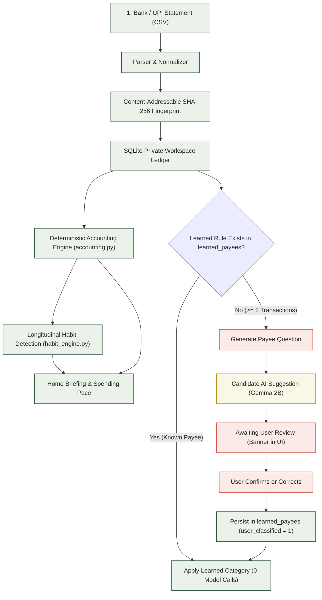
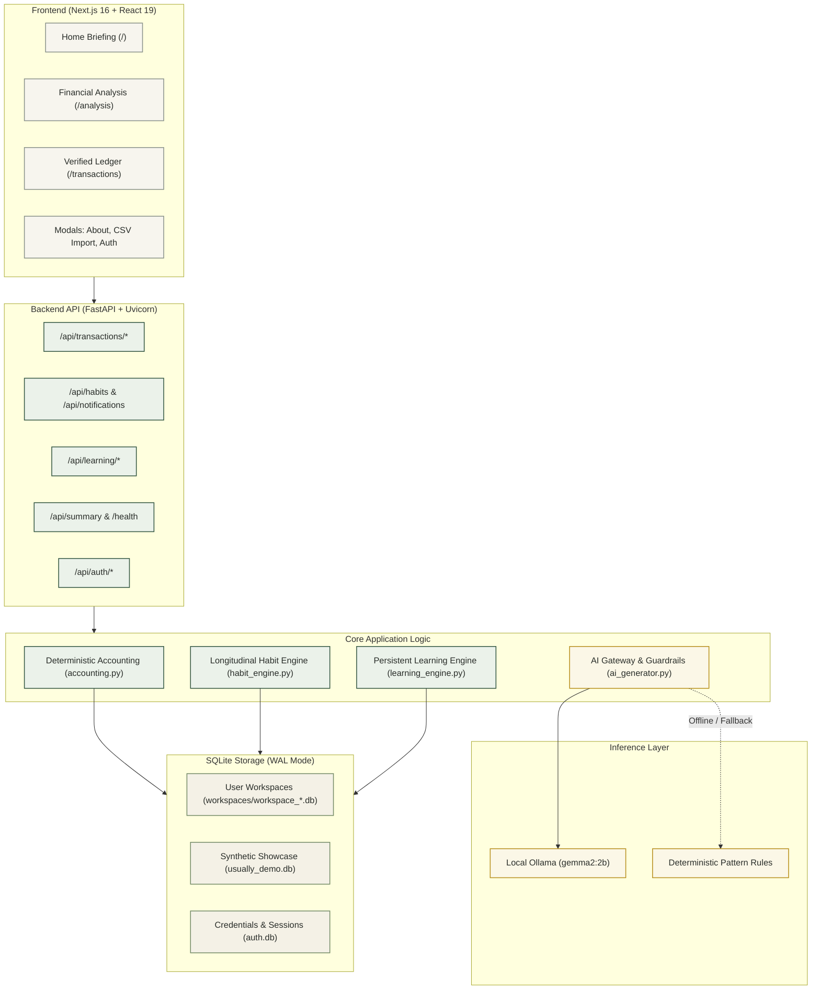
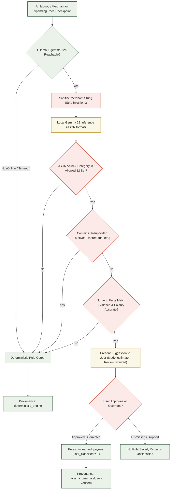
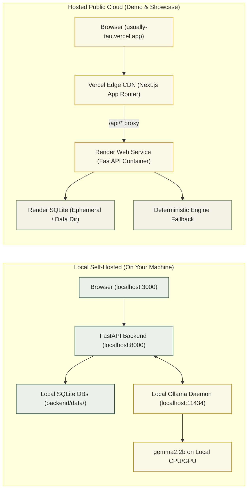
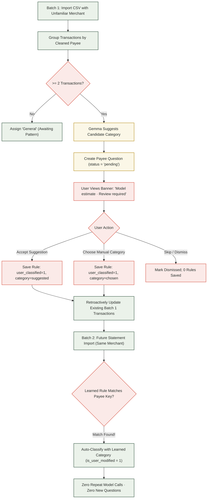

# Usually — Your Money Has Habits

> A quiet, local-first personal finance AI companion designed with a warm, editorial notebook aesthetic.
> Themed **“Slow and Steady”** with a peaceful sloth identity.

[](https://opensource.org/licenses/MIT)
[](https://github.com/debashis-sharingan-21/usually)
[](https://github.com/debashis-sharingan-21/usually)
[](https://nextjs.org/)
[](https://fastapi.tiangolo.com/)
[](https://ollama.com/)
[](https://usually-tau.vercel.app/)

Usually is **not** a generic expense tracker, a spreadsheet clone, or an intrusive budgeting bot. It observes verified recurring rhythms in your transaction ledger (such as dining cadences, commute patterns, and weekend spending surges) and turns them into concise, evidence-grounded observations at your own pace.

> **Core Philosophy:**  
> *“Automate the routine, ask about the ambiguous, remember the answer.”*

---

## Quick Links

- **Live Web Application:** [https://usually-tau.vercel.app/](https://usually-tau.vercel.app/)
- **Live Cloud Backend:** [https://usually.onrender.com/](https://usually.onrender.com/) (Health: [/health](https://usually.onrender.com/health))
- **GitHub Repository:** [https://github.com/debashis-sharingan-21/usually](https://github.com/debashis-sharingan-21/usually)
- **Interactive Product Story:** Click the **About** pill in the application navbar on any page to open *“The Story Behind Usually”*.

---

## Table of Contents

1. [Product Overview](#product-overview)
2. [Visual Experience & Views](#visual-experience--views)
3. [Architecture & Workflow Diagrams](#architecture--workflow-diagrams)
   - [Diagram A: Product Workflow](#diagram-a--product-workflow)
   - [Diagram B: System Architecture](#diagram-b--system-architecture)
   - [Diagram C: AI Decision Flow & Guardrails](#diagram-c--ai-decision-flow--guardrails)
   - [Diagram D: Local vs. Hosted Deployment](#diagram-d--local-versus-hosted-deployment)
   - [Diagram E: Data & Persistent Learning Lifecycle](#diagram-e--data--persistent-learning-lifecycle)
4. [Technology Stack](#technology-stack)
5. [Local Installation & Setup Guide](#local-installation--setup-guide)
   - [Prerequisites](#prerequisites)
   - [Terminal 1: Backend Setup](#terminal-1-backend-setup)
   - [Terminal 2: Frontend Setup](#terminal-2-frontend-setup)
   - [Terminal 3: Optional Local Ollama & Gemma Setup](#terminal-3-optional-local-ollama--gemma-setup)
   - [Verifying Genuine Gemma Inference](#verifying-genuine-gemma-inference)
6. [API Reference & Data Models](#api-reference--data-models)
7. [Testing & Quality Assurance](#testing--quality-assurance)
8. [Privacy, Storage & Limitations Honestly Explained](#privacy-storage--limitations-honestly-explained)
9. [Project Structure](#project-structure)
10. [Contribution Guide & Pre-PR Checklist](#contribution-guide--pre-pr-checklist)
11. [Roadmap](#roadmap)
12. [License & Acknowledgments](#license--acknowledgments)

---

## Product Overview

Traditional personal finance tools force users into one of two extremes: rigid manual bookkeeping that feels like homework, or aggressive cloud aggregators that demand bank credentials and push guilt-inducing notifications.

Usually takes an editorial, calm, and deliberate path inspired by physical journals:

1. **Deterministic Financial Source of Truth:** Pure arithmetic calculations determine income, living expenses, transfers, refunds, and checkpoint pacing. Credit card payoffs and self-transfers are partitioned into transfer categories to prevent false inflation of consumption figures.
2. **Longitudinal Habit Memory:** A statistical cadence detector identifies recurring merchant behaviors (e.g., *“You usually spend ₹450 on Swiggy on Wednesdays”*) backed strictly by dates, transaction counts, and historical evidence.
3. **Assistive AI (Without the Hype):** Open-weight Google Gemma 2B running locally via Ollama suggests categories for unfamiliar or ambiguous payees based on raw bank descriptors.
4. **Persistent Learning Loop:** When you confirm or correct a suggested category, Usually permanently records your decision in `learned_payees` with `user_classified = 1`. Future statement imports match deterministically with **zero repeat model calls**.
5. **Facts, Not Assumed Motives:** Usually observes spending trajectories, but **never assumes why you spent money**. Strict guardrails reject psychological hallucinations or lifestyle motives (*“spending spree”*, *“fun October”*, *“treating yourself”*, *“retail therapy”*), immediately falling back to deterministic wording.

---

## Visual Experience & Views

Usually is organized around three primary spaces accessible from a unified navigation bar:

```
┌────────────────────────────────────────────────────────────────────────┐
│  Usually [Slow & Steady]      Home    Analysis    Transactions   About  │
└────────────────────────────────────────────────────────────────────────┘
```

### 1. Home Briefing (`/`)
- **Executive Financial Briefing:** Surfaces the primary money observation of the month with headline, narrative, and supporting evidence cards.
- **Provenance Badges:** Real model outputs display `Gemma 2B · Grounded` and `Narrated by Gemma 2B (Local Ollama)`; offline/hosted fallbacks display `Deterministic Pattern Rules`.
- **Ambiguous Payee Question Banner:** Prompts user review for unfamiliar merchants with candidate proposals clearly labeled as `Model estimate · Review required`.
- **Cadence Cards:** Visualizes recurring rhythms (weekday cadences, top merchants, weekend spending).

### 2. Financial Analysis (`/analysis`)
- **Spending Pace Benchmark:** Evaluates cumulative outflow through Day $N$ against equivalent historical monthly checkpoints.
- **Gemma Pace Interpretation:** Narrates whether spending is tracking ahead of, behind, or aligned with typical baselines, strictly grounded in calculated figures.
- **Category Outflow Breakdown:** Clean visual distribution of spending across 12 canonical categories.

### 3. Verified Ledger (`/transactions`)
- **Inspectable Ledger:** Search, filter by category, filter by direction (Debit / Credit), and inspect transaction fingerprints.
- **Editable Transactions:** Modify categories on the fly with retroactive ledger recalculation.
- **CSV Import Modal:** Drag-and-drop statement importer supporting standard CSV, TSV, and PhonePe statement formats.

### 4. Application Previews

<!-- APPLICATION PREVIEWS INSTRUCTIONS:
To add visual screenshots to this section:
1. Capture screenshots at 1280x800 resolution for Home, Analysis, and Transactions.
2. Save them to docs/screenshots/home.png, docs/screenshots/analysis.png, docs/screenshots/transactions.png.
3. Replace the text preview cards below with standard markdown image tags: 
-->

<details open>
<summary><strong>Text Walkthrough of Key Screens</strong> (Click to collapse)</summary>

```
┌────────────────────────────────────────────────────────────────────────────────┐
│ HOME BRIEFING: Top Money Observation                                           │
│ ────────────────────────────────────────────────────────────────────────────── │
│ "Midweek Dining Cadence"                                                       │
│ Through October, Wednesday dining on Swiggy averaged ₹450 across 4 orders.     │
│ [Gemma 2B · Grounded] [90% verified] [₹1,800 total]                           │
│                                                                                │
│ Supporting Evidence Facts (Local SQLite Verified):                             │
│ • Target Day: Wednesday (4 of 5 matching days)                                 │
│ • Typical Range: ₹380 – ₹520 per order                                         │
└────────────────────────────────────────────────────────────────────────────────┘

┌────────────────────────────────────────────────────────────────────────────────┐
│ MERCHANT REVIEW: Ambiguous Payee Prompt                                        │
│ ────────────────────────────────────────────────────────────────────────────── │
│ I noticed 2 payments to 'GreenGrocer Organics Bengaluru' totaling ₹2,340.      │
│ [Gemma suggestion · review before saving] [Model estimate · Review required]   │
│ Suggested: Services & Groceries                                                │
│ "Merchant descriptor indicates an organic food and grocery store."             │
│ [Accept Suggestion]  Or choose: [Food & Dining] [Shopping] [General] [Skip]   │
└────────────────────────────────────────────────────────────────────────────────┘

┌────────────────────────────────────────────────────────────────────────────────┐
│ FINANCIAL ANALYSIS: Spending Pace Benchmark                                    │
│ ────────────────────────────────────────────────────────────────────────────── │
│ Month-to-Date Outflow (Through Day 15): ₹34,200                                │
│ Historical Baseline Checkpoint: ₹28,500 (+20.0% higher)                        │
│ Gemma Pace Interpretation [Local Ollama]:                                      │
│ "Spending for Day 15 of October is ₹34,200.0, pacing 20.0% higher than your    │
│ historical baseline of ₹28,500.0."                                             │
└────────────────────────────────────────────────────────────────────────────────┘
```

</details>

---

## Architecture & Workflow Diagrams

### Diagram A: Product Workflow

The diagram below traces how a bank statement moves from upload through deterministic calculations, pattern detection, candidate AI categorization, user review, and persistent memory.



> **Explanation:** Green elements represent deterministic mathematical calculations, database storage, and learned rule reuse. Mustard represents AI candidate suggestions. Coral represents stages requiring explicit human review.

---

### Diagram B: System Architecture

Usually's architecture separates client presentation, API routing, deterministic accounting, and optional local AI inference.



> **Explanation:** The Next.js frontend communicates exclusively via REST endpoints to the FastAPI backend. Core calculations write directly to isolated SQLite databases. Ollama runs as an auxiliary local process; if absent, the backend operates 100% deterministically.

---

### Diagram C: AI Decision Flow & Guardrails

This diagram illustrates how AI outputs are generated, validated, and prevented from hallucinating numbers or inventing motives.



> **Explanation:** Three strict guardrails protect financial integrity: (1) schema enforcement, (2) psychological motive rejection, and (3) numeric claim and polarity verification. Any failure immediately defaults to deterministic output.

---

### Diagram D: Local versus Hosted Deployment

A clear architectural comparison between local on-device execution and the hosted public demo.



> **Explanation:** In local development, Ollama runs `gemma2:2b` directly on device with zero cloud telemetry. On the hosted Render container, Ollama is absent; Usually automatically uses its deterministic pattern engine.

---

### Diagram E: Data & Persistent Learning Lifecycle

How unfamiliar merchants are flagged, reviewed, committed to persistent memory, and reused on subsequent statement imports.



> **Explanation:** Confirmation transforms an unverified AI heuristic into an authoritative, permanent rule in `learned_payees`. All subsequent imports for that merchant are classified deterministically without invoking the LLM.

---

## Technology Stack

Every component listed below exists and is verified in the repository:

| Layer | Technology | Version | Purpose in Usually |
| :--- | :--- | :--- | :--- |
| **Frontend Framework** | [Next.js](https://nextjs.org/) | `16.4.2` | App Router, static page prerendering, Turbopack compilation |
| **UI Library** | [React](https://react.dev/) | `19.3.1` | Component architecture, declarative state management |
| **Styling** | [Tailwind CSS](https://tailwindcss.com/) | `4.3.3` | Notebook-ruled surfaces, tactile buttons, typography system |
| **Icons & Visuals** | [Lucide React](https://lucide.dev/) | `1.60.0` | Restrained UI iconography |
| **Smooth Motion** | [GSAP](https://greensock.com/) + [Lenis](https://lenis.darkroom.engineering/) | `3.15` / `1.1` | Editorial page scroll & sleeping sloth micro-interactions |
| **Backend Framework** | [FastAPI](https://fastapi.tiangolo.com/) | `0.154.0` | High-performance async REST API, dependency injection, CORS |
| **ASGI Server** | [Uvicorn](https://www.uvicorn.org/) | `0.30.0` | Async production application server |
| **Data Validation** | [Pydantic](https://docs.pydantic.dev/) | `2.8.0+` | Strict request/response schemas, type safety |
| **Database** | [SQLite3](https://sqlite.org/) | Built-in | WAL mode, per-user workspace isolation, relational integrity |
| **Local AI Inference** | [Ollama](https://ollama.com/) + [Gemma 2B](https://ai.google.dev/gemma) | `gemma2:2b` | Open-weight 2B model for merchant category hints & pacing notes |
| **HTTP Client** | [HTTPX](https://www.python-httpx.org/) | `0.28.1` | Internal Ollama communication & async test client |
| **Backend Testing** | [pytest](https://docs.pytest.org/) | `9.1.1` | 103 unit and integration tests across accounting & AI |
| **Frontend Testing** | Node.js Test Runner | `v20+` | 14 unit tests using `node:test` and `--experimental-strip-types` |
| **Frontend Linter** | [Oxlint](https://oxc-project.github.io/) | `1.88.0` | Ultra-fast Rust-based static linting |
| **Hosting (Frontend)** | [Vercel](https://vercel.com/) | Cloud | Global edge CDN, Next.js proxying to Render backend |
| **Hosting (Backend)** | [Render](https://render.com/) | Cloud | Containerized Web Service for FastAPI application |

---

## Local Installation & Setup Guide

Run Usually locally on your machine with isolated SQLite storage and optional local Gemma 2B inference.

### Prerequisites

- **Python:** `3.10+` (tested on Python `3.11` and `3.13`)
- **Node.js:** `18+` (tested on Node `v20` and `v24`)
- **Git:** Standard git client
- *(Optional, for local AI)* [Ollama for Windows](https://ollama.com/download/windows) with `gemma2:2b`

---

### Terminal 1: Backend Setup (Windows PowerShell)

```powershell
# 1. Clone the repository
git clone https://github.com/debashis-sharingan-21/usually.git
cd usually

# 2. Create and activate a Python virtual environment
python -m venv backend/venv
.\backend\venv\Scripts\Activate.ps1

# 3. Install backend dependencies
pip install -r backend/requirements.txt

# 4. (Optional) Configure environment variables
$env:USUALLY_DEPLOYMENT_MODE="local"
$env:OLLAMA_BASE_URL="http://127.0.0.1:11434"
$env:OLLAMA_MODEL="gemma2:2b"

# 5. Start the FastAPI backend server
uvicorn app.main:app --app-dir backend --host 127.0.0.1 --port 8000 --reload
```

The backend server starts at `http://127.0.0.1:8000`.  
Interactive Swagger documentation is available at `http://127.0.0.1:8000/docs`.

---

### Terminal 2: Frontend Setup (Windows PowerShell)

```powershell
# 1. Navigate to the frontend directory
cd D:\usually\frontend

# 2. Install dependencies
npm install

# 3. Start the Next.js development server
npm run dev
```

Open `http://localhost:3000` in your web browser.  
All statement parsing, database mutations, and habit tracking run strictly on your machine.

---

### Terminal 3: Optional Local Ollama & Gemma Setup (Windows PowerShell)

If you wish to run on-device AI inference with Google Gemma 2B:

```powershell
# 1. Verify Ollama is installed and running
ollama --version

# 2. Pull the Gemma 2B model (~1.6 GB)
ollama pull gemma2:2b

# 3. Verify that the model is active and discoverable
ollama list
curl http://localhost:11434/api/tags
```

Usually automatically detects Ollama on startup. If Ollama is not installed or offline, Usually seamlessly operates in 100% deterministic mode.

---

### Verifying Genuine Gemma Inference

Usually provides three distinct mechanisms to verify that local Gemma inference is active:

1. **Interactive UI Verification:**
   - On `http://localhost:3000`, the Home briefing displays:  
     `Gemma 2B · Grounded` and `Narrated by Gemma 2B (Local Ollama)`.
   - On `/analysis`, the Spending Pace Benchmark displays:  
     `Gemma Pace Interpretation` with a `Local Ollama` badge.
   - On `/transactions`, importing an ambiguous merchant shows the review banner with:  
     `Gemma suggestion · review before saving` and `Model estimate · Review required`.
2. **Dedicated 9-Step Verification Script:**
   ```powershell
   .\backend\venv\Scripts\python scripts/verify_gemma_e2e.py
   ```
   Runs a non-destructive 9-step automated walkthrough verifying model reachability, candidate suggestions, user approval, persistent rule storage, zero repeat calls on second import, manual overrides, and read-only database safety.
3. **Live Model Pytest Suite:**
   ```powershell
   .\backend\venv\Scripts\pytest backend/tests/test_live_gemma_e2e.py -v
   ```

---

## API Reference & Data Models

### Key Endpoints

| Method | Endpoint | Description | Auth / Context |
| :--- | :--- | :--- | :--- |
| `GET` | `/health` | System health, active context, Ollama reachability, tone | Public |
| `GET` | `/` | API root, version, deployment mode | Public |
| `GET` | `/api/summary` | Deterministic income, outflow, transfers, and spending pace | Session Context |
| `GET` | `/api/habits` | Longitudinal recurring habit observations | Session Context |
| `GET` | `/api/notifications` | Active habit notifications within the 30-day window | Session Context |
| `GET` | `/api/transactions` | Paginated ledger with category, direction, and search filters | Session Context |
| `POST` | `/api/transactions/import` | Multipart CSV/TSV statement import with deduplication | Personal Only |
| `PUT` | `/api/transactions/{id}` | Edit transaction category, notes, or classification | Personal Only |
| `GET` | `/api/learning/questions` | Pending ambiguous payee review questions | Personal Only |
| `POST` | `/api/learning/questions/{id}/suggest` | Request on-demand Gemma classification for an ambiguous payee | Personal Only |
| `POST` | `/api/learning/answer` | Confirm or correct a suggestion; writes to `learned_payees` | Personal Only |
| `POST` | `/api/learning/dismiss/{id}` | Dismiss a payee question without saving a persistent rule | Personal Only |
| `POST` | `/api/auth/guest` | Instant 1-click isolated guest workspace session | Public |
| `POST` | `/api/auth/register` | Register an email/password account with PBKDF2 hashing | Public |
| `POST` | `/api/auth/login` | Login to retrieve bearer session token | Public |
| `DELETE`| `/api/auth/workspace` | Permanently unlink workspace SQLite `.db`, `-wal`, and `-shm` | Personal Only |

---

### Core Data Models

```sql
-- Transactions table (Primary ledger)
CREATE TABLE transactions (
    id INTEGER PRIMARY KEY AUTOINCREMENT,
    import_batch_id TEXT NOT NULL,
    date TEXT NOT NULL,
    raw_description TEXT NOT NULL,
    clean_merchant TEXT NOT NULL,
    category TEXT NOT NULL,
    amount REAL NOT NULL,
    direction TEXT NOT NULL,    -- 'debit' or 'credit'
    type TEXT NOT NULL,         -- 'income', 'expense', 'transfer', 'p2p'
    currency TEXT NOT NULL DEFAULT 'INR',
    fingerprint TEXT NOT NULL UNIQUE,
    is_user_modified INTEGER NOT NULL DEFAULT 0,
    created_at TEXT NOT NULL
);

-- Persistent memory table (Zero-repeat inference)
CREATE TABLE learned_payees (
    payee_key TEXT PRIMARY KEY, -- Lowercase normalized merchant string
    clean_name TEXT NOT NULL,
    category TEXT NOT NULL,
    transaction_type TEXT NOT NULL DEFAULT 'expense',
    notes TEXT,
    user_classified INTEGER NOT NULL DEFAULT 1,
    created_at TEXT NOT NULL,
    updated_at TEXT NOT NULL
);

-- Payee review questions
CREATE TABLE payee_questions (
    id TEXT PRIMARY KEY,
    payee_key TEXT NOT NULL,
    payee_name TEXT NOT NULL,
    prompt TEXT NOT NULL,
    options_json TEXT NOT NULL,
    transaction_count INTEGER NOT NULL,
    total_amount REAL NOT NULL,
    status TEXT NOT NULL DEFAULT 'pending', -- 'pending', 'answered', 'dismissed'
    suggested_category TEXT,
    suggested_type TEXT,
    ai_reason TEXT,
    ai_confidence REAL,
    suggested_by TEXT,
    created_at TEXT NOT NULL,
    updated_at TEXT NOT NULL
);
```

---

## Testing & Quality Assurance

Usually enforces a strict testing regimen across both frontend and backend.

```
Total Test Count: 117 Automated Tests (103 Backend + 14 Frontend)
Status: 100% Passing
```

### 1. Offline Backend Test Suite (Zero Daemon Dependencies)
```powershell
.\backend\venv\Scripts\pytest -m "not live_gemma" backend
# Result: 100 passed, 3 deselected in 220s
```
Covers:
- `test_financial_invariants.py` (16 tests): Non-negative amounts, balance identities, delimiter resilience.
- `test_user_isolation.py` (9 tests): Physical file segregation, cross-tenant denial, atomic deletion.
- `test_public_demo.py` (12 tests): Server-side read-only guards, synthetic data pinning.
- `test_csv_importer.py` & `test_phonepe_2026_parsing.py` (10 tests): Resilient CSV/TSV parsing.
- `test_habits.py` & `test_notifications_endpoint.py` (12 tests): Cadence math, 30-day windowing.
- `test_ai_merchant_labeling.py` (11 tests): Prompt injection defense, motive rejection, polarity guards.
- `test_ai_fallback.py` (7 tests): Numeric claim validation, safe digits, offline fallback.

### 2. Live Gemma Local Inference Suite
```powershell
.\backend\venv\Scripts\pytest backend/tests/test_live_gemma_e2e.py -v
# Result: 3 passed in 2.18s
```
Executes real on-device inferences against local `gemma2:2b` via Ollama for merchant categorization, learning persistence, and spending-pace narration.

### 3. Frontend Test Suite
```powershell
npm test --prefix frontend
# Result: 14 passed in 166ms
```
Verifies workspace read-only guards, demo context isolation, notification error formatting, and About product story validation.

### 4. Frontend Lint & Build
```powershell
npm run lint --prefix frontend    # Oxlint: 0 errors across 30 files
npm run build --prefix frontend   # Next.js: Compiled all 5 static pages successfully
```

---

## Privacy, Storage & Limitations Honestly Explained

Usually believes in verifiable transparency rather than marketing buzzwords:

| Dimension | Local Self-Hosted Mode | Hosted Cloud Demo (Render + Vercel) |
| :--- | :--- | :--- |
| **Data Storage Location** | Local hard drive (`backend/data/`) | Render container storage (`/data/workspaces/`) |
| **Network Telemetry** | **Zero.** No data leaves your machine | Requests routed via HTTPS to Render backend |
| **AI Inference Location** | Local CPU/GPU via Ollama (`gemma2:2b`) | **No local Ollama attached.** Uses deterministic fallback |
| **Workspace Persistence** | Permanent SQLite files on disk | Ephemeral on free containers (resets on container spin-down) |
| **Data Deletion** | Delete SQLite file or call `DELETE /api/auth/workspace` | 1-click `DELETE /api/auth/workspace` unlinks `.db`, `-wal`, `-shm` |
| **Authentication** | Optional (single-user default) | Bearer session tokens (`secrets.token_urlsafe(32)`) |

> [!WARNING]
> **Hosted Cloud Limitations:**  
> The live deployment on Render runs on a free-tier container without persistent disk volume attachment. Guest workspaces and personal statements persist for the duration of the active container session. For permanent storage, run Usually locally on your own computer or mount a persistent disk volume to `/data`.

---

## Project Structure

```
usually/
├── README.md                   # Authoritative project documentation & architecture
├── LICENSE                     # MIT License
├── pytest.ini                  # Pytest configuration with live_gemma marker
│
├── backend/
│   ├── requirements.txt        # Python dependencies (FastAPI, Uvicorn, Pydantic, HTTPX, Pytest)
│   ├── Dockerfile              # Production container specification for Render
│   ├── app/
│   │   ├── main.py             # FastAPI entrypoint, CORS, and router registration
│   │   ├── config.py           # Environment variables, file paths, and origins
│   │   ├── database.py         # SQLite schema, non-destructive migrations, connection factory
│   │   ├── guards.py           # Read-only demo guards and permission barriers
│   │   ├── workspace.py        # Per-user workspace resolution and session context
│   │   ├── models/             # Pydantic schemas (schema.py)
│   │   ├── routes/             # API route controllers (auth, habits, learning, etc.)
│   │   └── services/           # Business logic (accounting, habit_engine, ai_generator, etc.)
│   └── tests/                  # 103 backend automated regression and unit tests
│
├── frontend/
│   ├── package.json            # Next.js 16, React 19, Tailwind CSS, GSAP, Oxlint
│   ├── next.config.ts          # Turbopack config and backend API rewrites
│   ├── app/                    # Next.js App Router (layout, page, analysis, transactions)
│   └── src/
│       ├── api/                # Typed REST client with bearer token authentication
│       ├── components/         # React components (Navbar, AboutModal, CSVImportModal, etc.)
│       ├── context/            # StatementContext for global workspace and modal state
│       └── lib/                # Client utilities and 14 Node unit tests
│
└── scripts/
    ├── verify_gemma_e2e.py     # Standalone 9-step automated verification walkthrough
    ├── run-tests.ps1           # Quick test runner script
    └── start-backend.ps1       # Quick start script for backend
```

---

## Contribution Guide & Pre-PR Checklist

We welcome community contributions to Usually! To contribute:

1. **Fork & Branch:** Create a feature branch (`git checkout -b feat/your-feature`).
2. **Local Setup:** Follow the [Local Installation Guide](#local-installation--setup-guide) to set up your environment.
3. **Run Pre-PR Verification:**
   ```powershell
   # 1. Run offline backend test suite
   .\backend\venv\Scripts\pytest -m "not live_gemma" backend

   # 2. Run frontend tests
   npm test --prefix frontend

   # 3. Check linting
   npm run lint --prefix frontend

   # 4. Verify production build
   npm run build --prefix frontend
   ```
4. **Submit PR:** Submit a Pull Request against `main` describing the changes and linking relevant issues.

---

## Roadmap

The following proposed features represent the project's forward-looking design direction (clearly labeled as proposals):

- [ ] **Multi-Currency Normalization:** Automatic conversion across INR, USD, EUR, and GBP with daily cached exchange rates.
- [ ] **Native PDF Statement Extractor:** Local optical extraction for password-protected bank PDF statements.
- [ ] **Encrypted SQLite Backup & Export:** 1-click encrypted JSON/SQLite archive download for offline cold storage.
- [ ] **WebAssembly (WASM) Local Inference:** Exploring in-browser small-model execution via WebGPU for completely serverless zero-install private AI.

---

## License & Acknowledgments

- **License:** Released under the **[MIT License](LICENSE)**. Copyright (c) 2026 debashis-sharingan-21.
- **Acknowledgments:**
  - Built for the **Hacktoberfest 2026 Open-Source AI Challenge**.
  - Powered by Google's open-weight **Gemma 2B** (`gemma2:2b`) model.
  - Local model execution powered by **[Ollama](https://ollama.com/)**.
  - Peaceful sloth mascot and notebook-paper design system created with love for slow, thoughtful personal finance.
