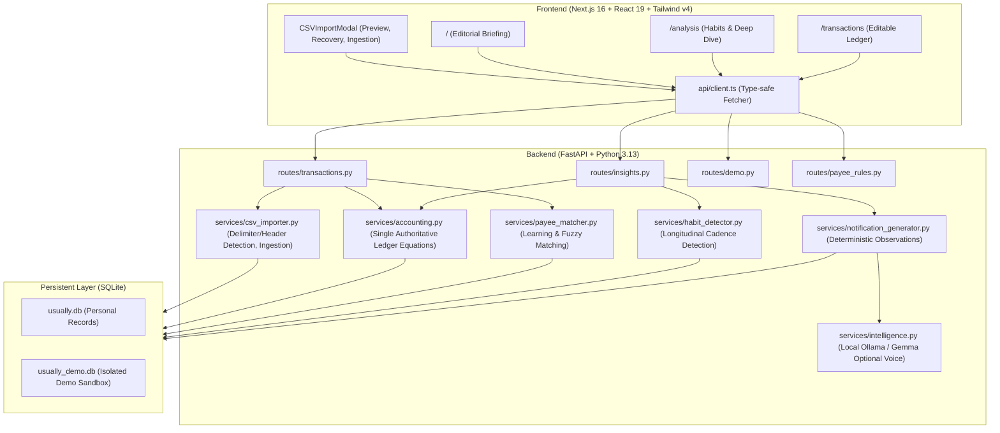

# USUALLY — Architecture Audit & System Inventory

## 1. System Inventory

Usually is a local-first personal finance companion designed for privacy, deterministic accounting, and longitudinal habit discovery. It combines strict double-entry-style directional integrity with conversational, witty observations and payee learning.

### 1.1 Architecture Topology



### 1.2 Frontend Inventory

- **Framework**: Next.js 16 (App Router), React 19, TypeScript 5.9, Tailwind CSS v4.
- **Pages**:
  - `frontend/src/app/page.tsx`: Daily personal briefing, headline spending numbers, high-priority habit card, top categories, and quick CSV import trigger.
  - `frontend/src/app/analysis/page.tsx`: Longitudinal habit breakdown, recurring commitments, cadence analysis, and discretionary vs non-discretionary trends.
  - `frontend/src/app/transactions/page.tsx`: Editable notebook ledger, multi-column search, category filtering, direction badges, pagination, inline payee correction, and CSV import actions.
- **Components**:
  - `CSVImportModal.tsx`: Viewport-constrained modal with file-selection lifecycle resilience, generic vs PhonePe statement preview, duplicate detection, and category preview.
  - `SlothMascot.tsx`: SVG brand identity visual with animated breathing/waving states.
  - `NotebookFooter.tsx`: Paper-stitched bottom signature footer with offline indicator and status.
  - `Navigation.tsx`: Minimalist editorial navigation bar with demo/personal mode indicator.
  - `DemoBanner.tsx`: Top warning bar indicating sandbox data mode.
- **Communication Layer**:
  - `frontend/src/api/client.ts`: Canonical API client exposing typed calls for transactions, summaries, payee rules, import previews, habit queries, and demo switching. Uses `NEXT_PUBLIC_API_URL` (default `http://localhost:8000`).

### 1.3 Backend Inventory

- **Framework**: FastAPI with Uvicorn ASGI server.
- **Database & Migration Engine**:
  - `backend/app/database.py`: Direct SQLite connection with WAL mode, foreign keys enabled, row factory mapping, and dynamic schema migration (`migrate_db()`).
  - Supports runtime database switching via `USUALLY_DB_PATH` or dynamic demo toggle.
- **Routers**:
  - `backend/app/routes/transactions.py`: Transaction listing, filtering, pagination, CSV preview (`/preview-csv`), CSV ingestion (`/import-csv`), manual transaction creation, and inline updates.
  - `backend/app/routes/insights.py`: Authoritative financial summary (`/summary`), habit detection list (`/habits`), and proactive notifications (`/notifications`).
  - `backend/app/routes/demo.py`: Resetting and populating demo database with 82 verified realistic transactions.
  - `backend/app/routes/payee_rules.py`: Listing, creating, updating, and deleting learned payee overrides.
- **Services**:
  - `backend/app/services/accounting.py`: Authoritative accounting calculations (Inflow, Outflow, Net, Discretionary vs Non-discretionary, Category breakdowns).
  - `backend/app/services/csv_importer.py`: Filename-agnostic delimiter sniffer, statement header detection (PhonePe 8-column, generic 4-to-10 column formats), transaction normalization, deduplication by `(date, ref_id, amount, clean_merchant)`.
  - `backend/app/services/payee_matcher.py`: Clean payee extraction from raw statement strings (UPI IDs, VPA, bank narration) and learning rule matching.
  - `backend/app/services/habit_detector.py`: Sliding window interval discovery for weekly, monthly, and quarterly recurring expenses.
  - `backend/app/services/notification_generator.py`: Deterministic rule-based observations with witty sloth tone.
  - `backend/app/services/intelligence.py`: Optional local LLM rewriting using Ollama (e.g. `gemma:2b`), completely bypassed if Ollama is unreachable.

### 1.4 Persistent Storage Schema

The system uses SQLite with strict schema definitions:
1. `transactions`:
   - `id` (INTEGER PRIMARY KEY)
   - `date` (TEXT, ISO-8601 YYYY-MM-DD)
   - `raw_merchant` (TEXT)
   - `clean_merchant` (TEXT, indexed)
   - `amount` (REAL, positive float)
   - `type` (TEXT: 'expense', 'income', 'transfer')
   - `direction` (TEXT: 'debit', 'credit', indexed)
   - `category` (TEXT, indexed)
   - `notes` (TEXT)
   - `source` (TEXT: 'csv', 'manual', 'demo')
   - `source_file` (TEXT)
   - `import_batch` (TEXT, indexed)
   - `ref_id` (TEXT, indexed)
   - `is_recurring` (INTEGER: 0 or 1)
   - `confidence` (REAL: 0.0 to 1.0)
   - `discretionary` (INTEGER: 0 or 1)
   - `created_at` (TEXT)
2. `payee_rules`:
   - `id` (INTEGER PRIMARY KEY)
   - `raw_pattern` (TEXT UNIQUE)
   - `clean_name` (TEXT)
   - `category` (TEXT)
   - `is_discretionary` (INTEGER)
   - `created_at` (TEXT)
3. `habits`:
   - `id` (INTEGER PRIMARY KEY)
   - `clean_merchant` (TEXT)
   - `category` (TEXT)
   - `cadence` (TEXT: 'daily', 'weekly', 'biweekly', 'monthly', 'quarterly', 'annual')
   - `average_amount` (REAL)
   - `confidence` (REAL)
   - `last_seen` (TEXT)
   - `occurrences` (INTEGER)
   - `is_active` (INTEGER)
4. `notifications`:
   - `id` (INTEGER PRIMARY KEY)
   - `title` (TEXT)
   - `body` (TEXT)
   - `type` (TEXT)
   - `severity` (TEXT)
   - `is_read` (INTEGER)
   - `created_at` (TEXT)

---

## 2. Simplest Sound System Design

### 2.1 Single Authoritative Accounting Formulas

To prevent calculation discrepancies between the briefing dashboard, deep analysis, and ledger tables, all financial calculations must flow through `backend/app/services/accounting.py`:

1. **Gross Cash Outflow**:
   $$\text{Gross Outflow} = \sum \text{amount} \quad \forall \; \text{direction} = \text{'debit'}$$
2. **Gross Cash Inflow**:
   $$\text{Gross Inflow} = \sum \text{amount} \quad \forall \; \text{direction} = \text{'credit'}$$
3. **Net Cash Movement**:
   $$\text{Net Cash Flow} = \text{Gross Inflow} - \text{Gross Outflow}$$
4. **Consumer Expenses (Living Costs)**:
   $$\text{Consumer Expenses} = \sum \text{amount} \quad \forall \; \text{direction} = \text{'debit'} \land \text{type} \neq \text{'transfer'}$$
5. **Consumer Inflows (Real Income)**:
   $$\text{Consumer Inflows} = \sum \text{amount} \quad \forall \; \text{direction} = \text{'credit'} \land \text{type} \neq \text{'transfer'}$$
6. **Consumer Net Margin**:
   $$\text{Consumer Net Margin} = \text{Consumer Inflows} - \text{Consumer Expenses}$$

### 2.2 Invariant Verification Principles

1. **Directional Invariant**: Every transaction is strictly either `debit` or `credit`. Amounts stored in the database are always positive numbers ($\text{amount} > 0$).
2. **Deterministic Fallback**: If Ollama or any external process is offline, the system produces 100% of insights, summaries, and notifications with zero errors and zero latency degradation.
3. **Zero Data Leakage**: Demo data and personal data reside in separate database files (`usually.db` vs `usually_demo.db`). Demo actions never mutate personal data.
4. **Idempotent Ingestion**: Importing the same statement twice produces 0 new records, 0 duplicate balance shifts, and 100% duplicate rejection.

---

## 3. Comprehensive REST API Reference

| Method | Endpoint | Description | Auth / Context |
| :--- | :--- | :--- | :--- |
| `GET` | `/health` | System health, active context, Ollama reachability, tone | Public |
| `GET` | `/` | API root, version, deployment mode | Public |
| `GET` | `/api/summary` | Deterministic income, outflow, transfers, and spending pace | Session Context |
| `GET` | `/api/habits` | Longitudinal recurring habit observations | Session Context |
| `GET` | `/api/notifications` | Active habit notifications within the 30-day window | Session Context |
| `GET` | `/api/transactions` | Paginated ledger with category, direction, and search filters | Session Context |
| `POST` | `/api/transactions/import` | Multipart CSV/TSV statement import with deduplication | Personal Only |
| `PUT` | `/api/transactions/{id}` | Edit transaction category, notes, or classification | Personal Only |
| `GET` | `/api/learning/questions` | Pending ambiguous payee review questions | Personal Only |
| `POST` | `/api/learning/questions/{id}/suggest` | Request on-demand Gemma classification for an ambiguous payee | Personal Only |
| `POST` | `/api/learning/answer` | Confirm or correct a suggestion; writes to `learned_payees` | Personal Only |
| `POST` | `/api/learning/dismiss/{id}` | Dismiss a payee question without saving a persistent rule | Personal Only |
| `POST` | `/api/auth/guest` | Instant 1-click isolated guest workspace session | Public |
| `POST` | `/api/auth/register` | Register an email/password account with PBKDF2 hashing | Public |
| `POST` | `/api/auth/login` | Login to retrieve bearer session token | Public |
| `DELETE`| `/api/auth/workspace` | Permanently unlink workspace SQLite `.db`, `-wal`, and `-shm` | Personal Only |

---

## 4. Extended Database Schemas

```sql
-- Persistent memory table (Zero-repeat inference)
CREATE TABLE learned_payees (
    payee_key TEXT PRIMARY KEY, -- Lowercase normalized merchant string
    clean_name TEXT NOT NULL,
    category TEXT NOT NULL,
    transaction_type TEXT NOT NULL DEFAULT 'expense',
    notes TEXT,
    user_classified INTEGER NOT NULL DEFAULT 1,
    created_at TEXT NOT NULL,
    updated_at TEXT NOT NULL
);

-- Payee review questions
CREATE TABLE payee_questions (
    id TEXT PRIMARY KEY,
    payee_key TEXT NOT NULL,
    payee_name TEXT NOT NULL,
    prompt TEXT NOT NULL,
    options_json TEXT NOT NULL,
    transaction_count INTEGER NOT NULL,
    total_amount REAL NOT NULL,
    status TEXT NOT NULL DEFAULT 'pending', -- 'pending', 'answered', 'dismissed'
    suggested_category TEXT,
    suggested_type TEXT,
    ai_reason TEXT,
    ai_confidence REAL,
    suggested_by TEXT,
    created_at TEXT NOT NULL,
    updated_at TEXT NOT NULL
);
```
